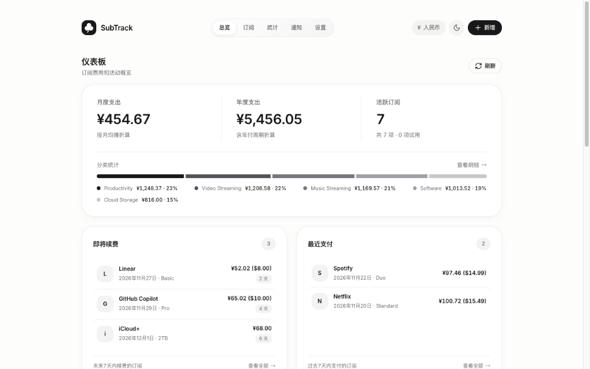

<p align="center">
  
</p>

<h1 align="center">SubTrack</h1>

<p align="center">
  A minimalist, modern, local-first personal subscription &amp; expense ledger.
</p>

<p align="center">
  <a href="https://github.com/aoomee/SubTrack/releases/tag/v1.0.0"></a>
  <a href="https://github.com/aoomee/SubTrack/actions/workflows/ci.yml"></a>
  <a href="https://github.com/aoomee/SubTrack/pkgs/container/subtrack"></a>
  <a href="LICENSE"></a>
</p>

<p align="center">
  <a href="#highlights">Highlights</a> ·
  <a href="#quick-start">Quick Start</a> ·
  <a href="#local-development">Development</a> ·
  <a href="README.md">简体中文</a>
</p>

<br />



## Highlights

- **Subscription Ledger** — Monthly, quarterly, semiannual, and yearly cycles with auto/manual renewals and full payment history
- **Expense Analytics** — Allocated monthly & yearly spending trends, category breakdowns, and an interactive billing calendar
- **Multi-Currency** — 9 built-in currencies with optional automatic exchange-rate sync and original-currency hints
- **Smart Reminders** — Telegram and email notifications with configurable lead times and schedules
- **Local-First & Portable** — Stored in your own SQLite database with JSON & CSV import/export
- **Minimalist Design** — Monochrome light/dark themes, Chinese & English UI, responsive across desktop and mobile

## Quick Start

### One-command Linux VPS install

```bash
curl -fsSL https://raw.githubusercontent.com/aoomee/SubTrack/main/scripts/install-vps.sh | bash
```

Pulls `ghcr.io/aoomee/subtrack:latest`, initializes persistent storage, and prints your initial admin credentials. Open `http://YOUR_SERVER_IP:3001` once ready.

### Docker Compose

Copy the Compose configuration from the [Chinese homepage](README.md#docker-compose) (or use [docker-compose.1panel.yml](docker-compose.1panel.yml) behind a reverse proxy), replace `CHANGE_ME` values, then run:

```bash
docker compose pull && docker compose up -d
```

Multi-arch images (`linux/amd64`, `linux/arm64`) are published to [`ghcr.io/aoomee/subtrack`](https://github.com/aoomee/SubTrack/pkgs/container/subtrack) under `latest` and `v1.0.0`.

## Local Development

Requires Node.js 20+:

```bash
# Terminal 1 — Frontend (http://localhost:5173)
npm install && npm run dev

# Terminal 2 — Backend (http://localhost:3001/api)
cd server && npm install && npm run db:init && npm start
```

Docs: [Production Env](.env.production.example) · [Deployment Guide](docs/DEPLOYMENT.zh-CN.md) · [Authentication](docs/AUTHENTICATION.md) · [Notifications](docs/NOTIFICATION_SYSTEM.md) · [API Reference](docs/API_DOCUMENTATION.md)

## License

Built upon the MIT-licensed [huhusmang/Subscription-Management](https://github.com/huhusmang/Subscription-Management) project and released under the [MIT License](LICENSE).
