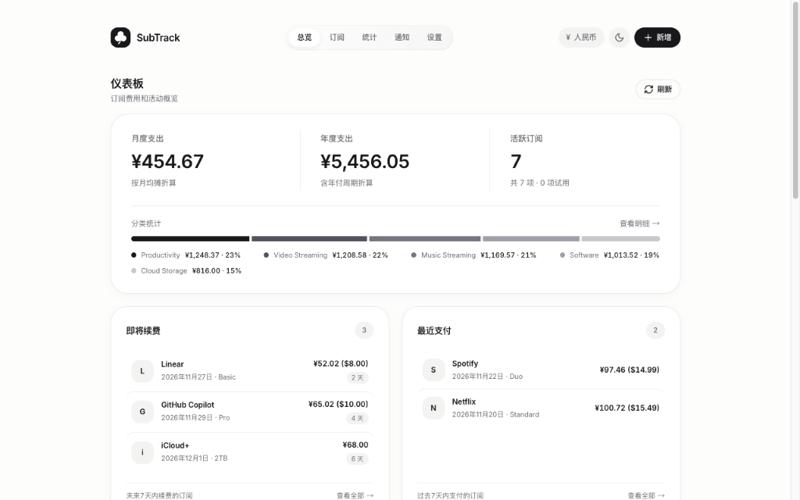
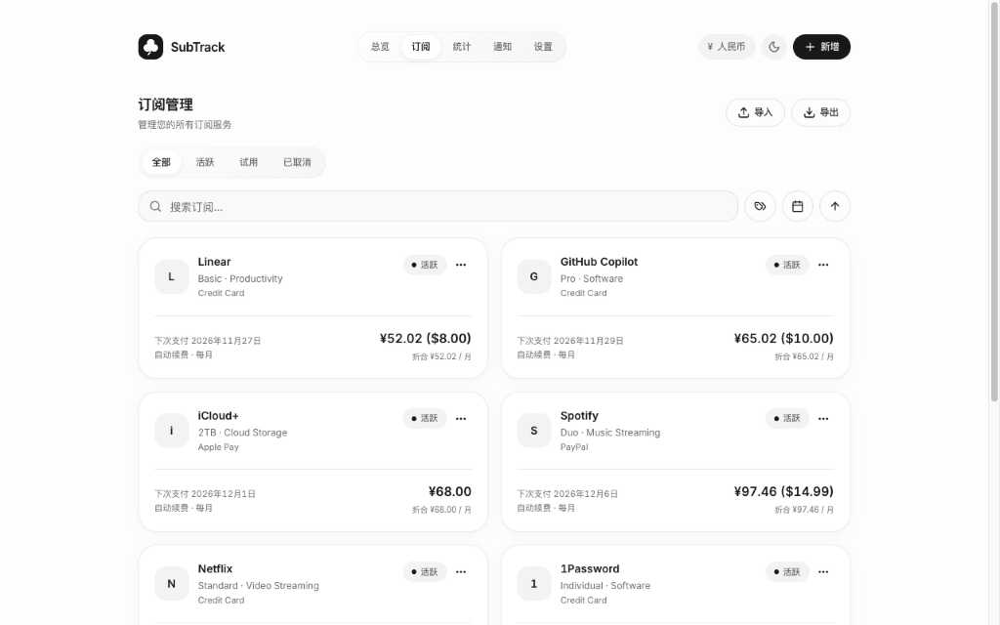
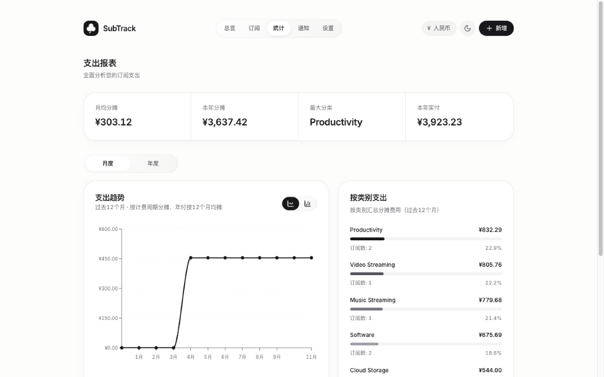

<p align="center">
  
</p>

<h1 align="center">SubTrack</h1>

<p align="center">
  极简、现代、本地优先的个人订阅与周期支出账本
</p>

<p align="center">
  <a href="https://github.com/aoomee/SubTrack/releases/tag/v1.0.0"></a>
  <a href="https://github.com/aoomee/SubTrack/actions/workflows/ci.yml"></a>
  <a href="https://github.com/aoomee/SubTrack/pkgs/container/subtrack"></a>
  <a href="LICENSE"></a>
</p>

<p align="center">
  <a href="#界面预览">界面预览</a> ·
  <a href="#一键部署">一键部署</a> ·
  <a href="#docker-compose">Docker Compose</a> ·
  <a href="#本地开发">本地开发</a> ·
  <a href="README.en.md">English</a>
</p>

<br />



## 核心特性

- **周期订阅账本**：支持月付、季付、半年付、年付，自动与手动续费全生命周期管理
- **支出分摊与统计**：按月/季/年分摊折算，趋势折线、分类柱图与扣款日历一目了然
- **多币种与汇率**：内置 9 种常用货币，支持原币对照显示与定时汇率同步
- **续费提醒通知**：支持 Telegram 与邮件通知渠道，可自定义提前提醒天数与发送时段
- **数据完全自主**：单文件 SQLite 本地存储，支持 JSON / CSV 导入导出
- **简约双色主题**：中英文界面、浅色 / 深色 / 跟随系统自适应，桌面与移动端均细腻适配

## 界面预览

| 订阅管理 | 支出报表 |
| :---: | :---: |
|  |  |

## 一键部署

适用于拥有 `root` 权限的 Linux VPS。脚本自动检查并安装 Docker、拉取最新镜像、创建持久化数据卷，并在完成时打印登录信息：

```bash
curl -fsSL https://raw.githubusercontent.com/aoomee/SubTrack/main/scripts/install-vps.sh | bash
```

自定义端口（例如 `8080`）：

```bash
curl -fsSL https://raw.githubusercontent.com/aoomee/SubTrack/main/scripts/install-vps.sh | env SUBTRACK_HOST_PORT=8080 bash
```

> 再次运行同一条命令即可无缝更新镜像，已有的 `.env`、管理员密码与 `subtrack-data` 数据卷会被保留。

## Docker Compose

保存为 `docker-compose.yml`，替换两处 `CHANGE_ME` 必填值后执行 `docker compose pull && docker compose up -d`：

```yaml
services:
  subtrack:
    image: ghcr.io/aoomee/subtrack:latest
    pull_policy: always
    container_name: subtrack
    restart: unless-stopped
    environment:
      NODE_ENV: production
      PORT: "3001"
      DATABASE_PATH: /app/data/database.sqlite
      # 必填：随机长字符串，可用 openssl rand -base64 48 生成
      SESSION_SECRET: "CHANGE_ME_TO_A_LONG_RANDOM_STRING"
      # 必填：管理员账号与密码
      ADMIN_USERNAME: "admin"
      ADMIN_PASSWORD: "CHANGE_ME_TO_A_STRONG_PASSWORD"
      BASE_CURRENCY: "CNY"
      SCHEDULER_TIMEZONE: "Asia/Shanghai"
      SCHEDULER_CHECK_TIME: "09:00"
      TRUST_PROXY: "1"
      SESSION_COOKIE_SECURE: "auto"
      SESSION_COOKIE_SAMESITE: "lax"
      # 可选：汇率与通知配置
      # TIANAPI_KEY: "YOUR_TIANAPI_KEY"
      # TELEGRAM_BOT_TOKEN: "YOUR_TELEGRAM_BOT_TOKEN"
      # EMAIL_HOST: "smtp.example.com"
      # EMAIL_PORT: "587"
      # EMAIL_SECURE: "false"
      # EMAIL_USER: "YOUR_SMTP_USERNAME"
      # EMAIL_PASSWORD: "YOUR_SMTP_PASSWORD"
      # EMAIL_FROM: "SubTrack <no-reply@example.com>"
    ports:
      - "3001:3001"
    volumes:
      - subtrack-data:/app/data
    healthcheck:
      test: ["CMD", "node", "-e", "const http=require('http');const req=http.request({hostname:'localhost',port:3001,path:'/api/health',timeout:2000},res=>process.exit(res.statusCode===200||res.statusCode===401?0:1));req.on('error',()=>process.exit(1));req.end();"]
      interval: 30s
      timeout: 3s
      start_period: 15s
      retries: 3

volumes:
  subtrack-data:
    name: subtrack-data
```

<details>
<summary>1Panel 反向代理、镜像标签与常用运维命令</summary>

### 1Panel / 仅监听本机端口

仓库提供专用模板 [docker-compose.1panel.yml](docker-compose.1panel.yml)（默认绑定 `127.0.0.1:3001`）。

### 镜像标签

镜像地址：[`ghcr.io/aoomee/subtrack`](https://github.com/aoomee/SubTrack/pkgs/container/subtrack)（支持 `linux/amd64` 与 `linux/arm64`）

| 标签 | 说明 |
| --- | --- |
| `latest` | 最新稳定版，推荐日常部署 |
| `v1.0.0` / `1.0.0` | 固定语义化版本镜像 |

### 常用命令

```bash
docker compose ps                       # 查看状态
docker compose logs -f --tail=100       # 查看日志
docker compose pull && docker compose up -d  # 更新镜像
docker compose down                     # 停止服务（勿加 -v，避免删除数据卷）
```

### 重置管理员密码

```bash
node /app/server/scripts/rotate-admin-password.js --password 'NEW_STRONG_PASSWORD'
```

</details>

## 本地开发

需要 Node.js 20+：

```bash
# 终端 1：启动前端（http://localhost:5173）
npm install && npm run dev

# 终端 2：启动后端（http://localhost:3001/api）
cd server && npm install && npm run db:init && npm start
```

更多文档：[环境变量示例](.env.production.example) · [部署说明](docs/DEPLOYMENT.zh-CN.md) · [认证与安全](docs/AUTHENTICATION.md) · [通知系统](docs/NOTIFICATION_SYSTEM.md) · [API 文档](docs/API_DOCUMENTATION.md)

## License

基于 MIT 许可的 [huhusmang/Subscription-Management](https://github.com/huhusmang/Subscription-Management) 持续演进，采用 [MIT License](LICENSE) 发布。
